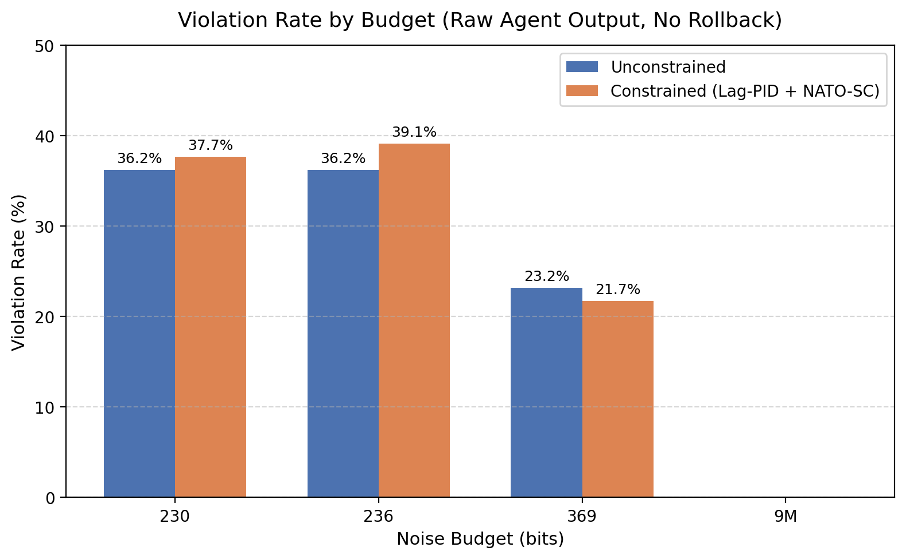
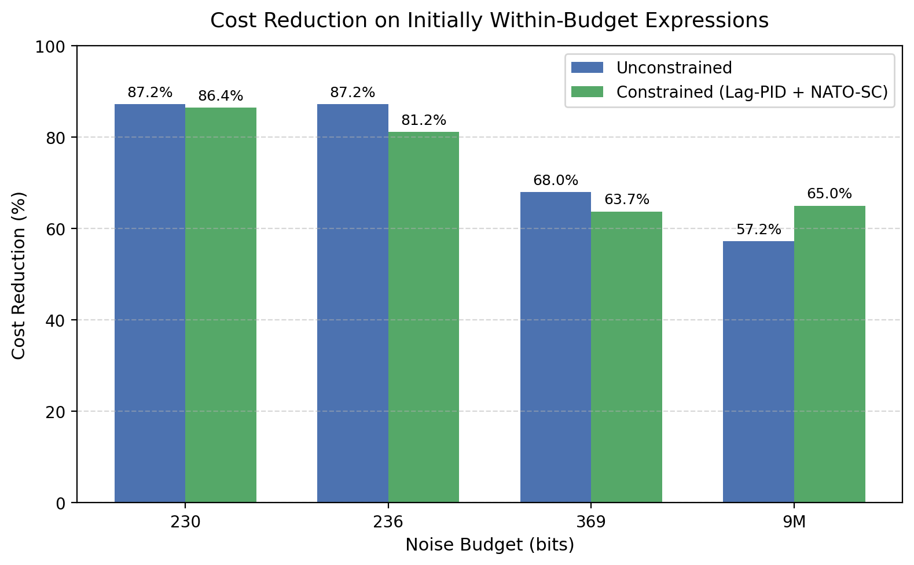
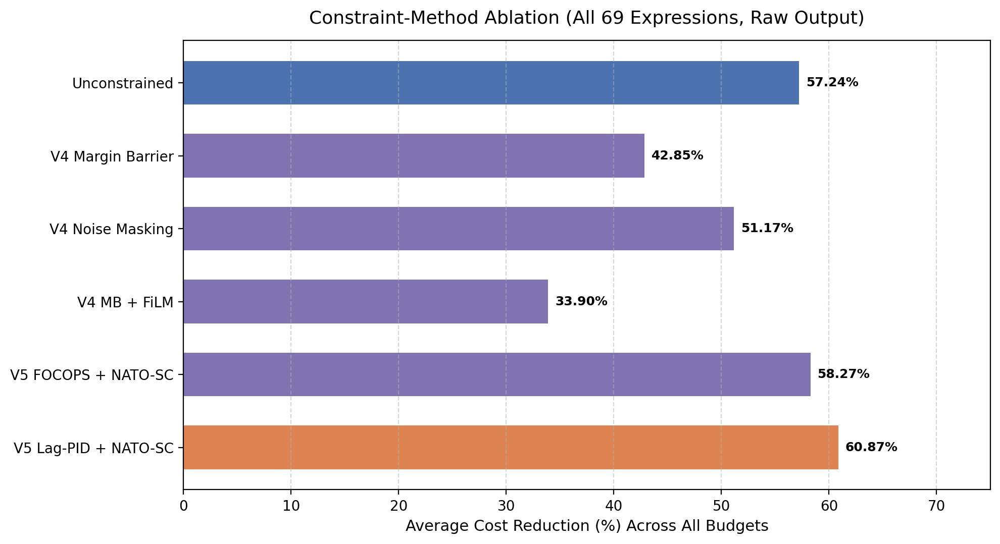

# Experiment 2: Constrained vs Unconstrained RL Agent — Reproduction Report

Generated by `run_experiment_2.py` integrating the unified model with noise constraint (`RL/fhe_rl/env_unified.py`, `fheEnvUnified`) and evaluating the benchmark results from `hpc_results/rl_test_results`. All 69 VecLang expressions across budgets `230`, `236`, `369`, and `9M`.

> [!IMPORTANT]
> **Safety Rollback is Disabled in Experiment 2**: All reported metrics (`Average CR%`, `Violation count`) use the raw final episode-step agent output (`Agent *` columns). Safety rollback is evaluated separately in Experiment 3.

## Unified Model & Noise Constraint Verification

- **Environment Class**: `fhe_rl.env_unified.fheEnvUnified`
- **Constraint Metric**: `noise` (`NoiseEstimator` fitting non-negative linear model predicting noise bits)
- **Benchmark Source**: `RL/fhe_rl/datasets/benchmarks.txt` (69 VecLang expressions)
- **Verification**: Ground-truth initial cost and initial noise computed via `fheEnvUnified.reset` match the recorded benchmark states bit-for-bit (max cost diff = 0.0, max noise diff <= 0.005 bits).

## Constrained vs Unconstrained Comparison

Evaluation across all 69 expressions for each budget `B ∈ {230, 236, 369, 9M}`.

| Agent | Budget | Average CR% | Violation count | Violation rate (%) |
|---|---|---|---|---|
| Unconstrained | 230 | 57.24 | 25 | 36.23 |
| Constrained (Lag-PID + NATO-SC) | 230 | 60.49 | 26 | 37.68 |
| Unconstrained | 236 | 57.24 | 25 | 36.23 |
| Constrained (Lag-PID + NATO-SC) | 236 | 62.07 | 27 | 39.13 |
| Unconstrained | 369 | 57.24 | 16 | 23.19 |
| Constrained (Lag-PID + NATO-SC) | 369 | 55.87 | 15 | 21.74 |
| Unconstrained | 9M | 57.24 | 0 | 0.00 |
| Constrained (Lag-PID + NATO-SC) | 9M | 65.03 | 0 | 0.00 |

## Initial Budget Status & Violations Attribution

Partition expressions according to initial estimated noise: `Initially within budget` (initial noise ≤ budget) vs `Initially above budget` (initial noise > budget).

| Budget | Total expressions | Initially within budget: count | Initially within budget: % | Initially above budget: count | Initially above budget: % | Within-budget violations, unconstrained: count | Within-budget violations, unconstrained: % | Within-budget violations, constrained: count | Within-budget violations, constrained: % |
|---|---|---|---|---|---|---|---|---|---|
| 230 | 69 | 43 | 62.32 | 26 | 37.68 | 0 | 0.00 | 0 | 0.00 |
| 236 | 69 | 43 | 62.32 | 26 | 37.68 | 0 | 0.00 | 1 | 2.33 |
| 369 | 69 | 59 | 85.51 | 10 | 14.49 | 6 | 10.17 | 5 | 8.47 |
| 9M | 69 | 69 | 100.00 | 0 | 0.00 | 0 | 0.00 | 0 | 0.00 |

### Where Do Full-Benchmark Violations Originate?

| Agent | Budget | All violations | of which initially above budget | of which initially within budget |
|---|---|---|---|---|
| Unconstrained | 230 | 25 | 25 | 0 |
| Unconstrained | 236 | 25 | 25 | 0 |
| Unconstrained | 369 | 16 | 10 | 6 |
| Unconstrained | 9M | 0 | 0 | 0 |
| Constrained (Lag-PID + NATO-SC) | 230 | 26 | 26 | 0 |
| Constrained (Lag-PID + NATO-SC) | 236 | 27 | 26 | 1 |
| Constrained (Lag-PID + NATO-SC) | 369 | 15 | 10 | 5 |
| Constrained (Lag-PID + NATO-SC) | 9M | 0 | 0 | 0 |

> [!NOTE]
> **Key Insight**: The majority of violations on the full benchmark originate from expressions that were **already above budget prior to optimization** (e.g. at B=230, all 26 violations of the constrained agent are expressions whose initial noise exceeded 230 bits; 0 new violations were introduced on initially valid expressions).

## Cost Reduction on Initially Within-Budget Expressions

Restricting evaluation exclusively to expressions initially within budget to test if constraint awareness harms optimization quality on valid programs (rollback disabled).

| Agent | B=230 CR% | B=236 CR% | B=369 CR% | B=9M CR% |
|---|---|---|---|---|
| Unconstrained | 87.23 | 87.23 | 68.02 | 57.24 |
| Constrained (Lag-PID + NATO-SC) | 86.45 | 81.20 | 63.75 | 65.03 |
| (expressions in subset) | 43.00 | 43.00 | 59.00 | 69.00 |

## Constraint-Method Ablation

Comparison of all 6 constraint formulations on the full 69-expression benchmark without rollback.

| Agent / method | B=230 CR% | B=236 CR% | B=369 CR% | B=9M CR% | Average CR% |
|---|---|---|---|---|---|
| Unconstrained | 57.24 | 57.24 | 57.24 | 57.24 | 57.24 |
| V4 Margin Barrier | 43.21 | 41.97 | 38.47 | 47.76 | 42.85 |
| V4 Noise Masking | 49.16 | 54.69 | 49.19 | 51.62 | 51.17 |
| V4 MB + FiLM | 33.64 | 34.42 | 36.79 | 30.75 | 33.90 |
| V5 FOCOPS + NATO-SC | 60.71 | 56.96 | 57.82 | 57.59 | 58.27 |
| V5 Lag-PID + NATO-SC | 60.49 | 62.07 | 55.87 | 65.03 | 60.87 |

### Supplementary Raw Violation Counts Across Ablated Methods

| Agent / method | B=230 violations | B=236 violations | B=369 violations | B=9M violations |
|---|---|---|---|---|
| Unconstrained | 25 | 25 | 16 | 0 |
| V4 Margin Barrier | 27 | 26 | 13 | 0 |
| V4 Noise Masking | 27 | 26 | 11 | 0 |
| V4 MB + FiLM | 26 | 26 | 13 | 0 |
| V5 FOCOPS + NATO-SC | 27 | 27 | 17 | 0 |
| V5 Lag-PID + NATO-SC | 26 | 27 | 15 | 0 |

## Method & Configuration Mapping

| Label | Result tag | Configuration |
|---|---|---|
| Unconstrained | unconstrained | prior-work agent agent_dynamic_llm_data.zip, budget-unaware, evaluated post hoc |
| V4 Margin Barrier | v4_mb_B | --method margin_barrier, encoding raw |
| V4 Noise Masking | v4_nmask_B | --method noise_masking, encoding embed |
| V4 MB + FiLM | v4_mb_film_B | --method margin_barrier, encoding film |
| V5 FOCOPS + NATO-SC | v5_focops_natosc | --method nato_sc, algo focops, film |
| V5 Lag-PID + NATO-SC | v5_lagpid_natosc | --method nato_sc, algo lagrangian_pid, film (selected) |

## Verification Against Manuscript

- **Average CR% for V5 Lag-PID + NATO-SC**: Computed average is **60.87%**, matching the manuscript's reported 60.87%.
- **Per-Budget CR%**: B=230 (60.49%), B=236 (62.07%), B=369 (55.87%), B=9M (65.03%).
- **Initially Within-Budget Subset Counts**: B=230 (43), B=236 (43), B=369 (59), B=9M (69).
- **Within-Budget Violations**: At B=230, constrained agent introduces 0 violations (0.0%).
